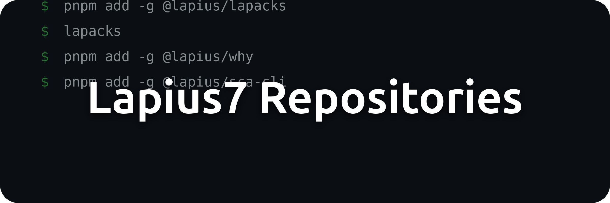

  

<a href="README.md">English</a> | <b>日本語</b>

<h1 align="center">Lapius7 Repositories</h1>

<h3 align="center">公開リポジトリの一覧。</h3>

<a href="https://github.com/Lapius7">Lapius7</a> の公開リポジトリのまとめです。CLI ツールはどれも <code>pnpm add -g @lapius/&lt;名前&gt;</code> で入ります（Linux / macOS / Windows）。

  
  

  <a href="#cli-ツール">CLI ツール</a> ·
  <a href="#web-サービスサーバー">Web サービス・サーバー</a> ·
  <a href="#デスクトップアプリブラウザ拡張">デスクトップアプリ・ブラウザ拡張</a> ·
  <a href="#ライブラリ">ライブラリ</a> ·
  <a href="#その他">その他</a>

---

## CLI ツール

| リポジトリ | コマンド | 説明 | 言語 | インストール |
|---|---|---|---|---|
| [lapacks](https://github.com/Lapius7/lapacks) | `lapacks` | @lapius の CLI ツール（下の表）をまとめて一覧・インストール・更新・削除する管理 CLI（TUI 付き） | Node.js | `pnpm add -g @lapius/lapacks` |
| [why](https://github.com/Lapius7/why) | `why` | 失敗したコマンドの原因と対処法を日本語で表示する（オフライン・AI なし） | Go | `pnpm add -g @lapius/why` |
| [ui-cli](https://github.com/Lapius7/ui-cli) | `ui` | [shadcn.lapius7.com](https://shadcn.lapius7.com) のコンポーネントを shadcn CLI 経由で入れる | TypeScript | `pnpm dlx @lapius/ui add <名前>` |
| [bin-cli](https://github.com/Lapius7/bin-cli) | `bin` | [LapBin](https://bin.lapius7.com) のクライアント。Lapount でログインしてターミナルからコードを共有 | Go | `pnpm add -g @lapius/bin-cli` |
| [ohatwikeeper-cli](https://github.com/Lapius7/ohatwikeeper-cli) | `ohax` | [おはツイKeeper](https://ohatwikeeper.com/cli) 公式 CLI。プロフィール・推移グラフ・アワードなどをフルカラーで表示 | Go | `pnpm add -g @lapius/ohatwikeeper-cli` |
| [sca-cli](https://github.com/Lapius7/sca-cli) | `sca` | supabase-chat-app のターミナルクライアント。ルーム作成・チャット・オンライン表示 | Go | `pnpm add -g @lapius/sca-cli` |
| [clilap](https://github.com/Lapius7/clilap) | `clilap` | [clilap.org](https://clilap.org) のクライアント。天気・チートシート・DNS・ハッシュなどをターミナルから | Node.js | `pnpm add -g @lapius/clilap` |
| [laping-lang](https://github.com/Lapius7/laping-lang) | `laping` | Laping (`.lp`) — C で実装した最小構成のプログラミング言語 | C | `pnpm add -g @lapius/laping-lang` |
| [password-gl](https://github.com/Lapius7/password-gl) | `password-gl` `pgl` | 条件を細かく指定できるパスワード / パスフレーズ生成（要 Python 3.9+） | Python | `pnpm add -g @lapius/password-gl` |
| [tsbuild](https://github.com/Lapius7/tsbuild) | `tsbuild` | Bun + TypeScript の開発サーバーをホットリロード付きで 1 コマンド起動（要 Python 3.9+） | Python | `pnpm add -g @lapius/tsbuild` |
| [tssetup](https://github.com/Lapius7/tssetup) | `tssetup` | Bun + TypeScript のフロントエンド環境を 1 コマンドで構築（要 Python 3.9+） | Python | `pnpm add -g @lapius/tssetup` |
| [go-uuid](https://github.com/Lapius7/go-uuid) | `go-uuid` | アクセスするたびに UUID (v1〜v7) を返す HTTP サーバー（[デモ](https://sandbox.lapius7.com/go-uuid/)） | Go | `pnpm add -g @lapius/go-uuid` |
| [clilap-codepush](https://github.com/Lapius7/clilap-codepush) | `codepush` | [codepush.clilap.org](https://codepush.clilap.org) の TUI クライアント | Python | `pnpm add -g @lapius/clilap-codepush` |
| [cli-othello](https://github.com/Lapius7/cli-othello) | `othello` | ターミナルで遊ぶオセロ。5 段階の AI と対戦 | Python | `pnpm add -g @lapius/cli-othello` |
| [ytdlpdownloader](https://github.com/Lapius7/ytdlpdownloader) | `yd` | yt-dlp を fzf のメニューで操作する動画・音声・画像ダウンローダー（YouTube 以外も、gallery-dl 連携） | zsh | `pnpm add -g @lapius/ytdlpdownloader` |
| [dela-cli](https://github.com/Lapius7/dela-cli) | `dela` | ローカルのポートを https://xxxx.deploy.lapius7.com で公開する CLI（自前の sish トンネル） | Go | `pnpm add -g @lapius/dela-cli` |
| [repomix-auto](https://github.com/Lapius7/repomix-auto) | `repomix-auto` | Repomix のソースマップ生成を自動化する CLI（鮮度確認・config 作成・重いファイルの自動除外） | TypeScript | `pnpm add -g @lapius/repomix-auto` |
| [x-archive-parser](https://github.com/Lapius7/x-archive-parser) | `x-archive-parser` | X（Twitter）のアーカイブを、コーディングエージェントが grep できる月別の Markdown / JSONL / CSV に変換する | TypeScript | `pnpm add -g @lapius/x-archive-parser` |

## Web サービス・サーバー

| リポジトリ | 説明 | 言語 |
|---|---|---|
| [clilap](https://github.com/Lapius7/clilap) | `curl clilap.org` で使える開発者向けツール集（天気・チートシート・GitHub・IP・DNS・WHOIS・UUID・Base64 など） | Python |
| [transit.lapius7.com](https://github.com/Lapius7/transit.lapius7.com) | Transit API を使った乗換案内 Web アプリ（[サイト](https://transit.lapius7.com)） | TypeScript |
| [discordwidget-reloader](https://github.com/Lapius7/discordwidget-reloader) | Discord Profile Widgets v2 の同期待ち表示を回避する定期 PATCH コンテナ | Python |
| [lapacks.lapius7.com](https://github.com/Lapius7/lapacks.lapius7.com) | @lapius パッケージ（lapacks で管理できる CLI）の使い方をまとめたドキュメントサイト。Markdown をパッケージごとのページとして表示（Next.js） | TypeScript |
| [md-publisher-api](https://github.com/Lapius7/md-publisher-api) | Markdown を API で送ると、URL を知る人だけが読めるページにするサービス | TypeScript |
| [discord-messageapi-bot](https://github.com/Lapius7/discord-messageapi-bot) | Discord のチャンネルに投稿された本文と画像を保存し、チャンネル専用のキーで取り出せるようにする Bot | TypeScript |
| [diserverbuilder-mcp](https://github.com/Lapius7/diserverbuilder-mcp) | AI アシスタント（Claude など）が、自分の Bot 経由で Discord サーバー（カテゴリ・チャンネル・ロール・権限）を組み立て直せる MCP サーバー | TypeScript |
| [gh.lapius7.com](https://github.com/Lapius7/gh.lapius7.com) | GitHub の活動ダッシュボード。依存なしの Node.js サーバーが GraphQL の統計をキャッシュして返す（[サイト](https://gh.lapius7.com)） | JavaScript |
| [img-parameter.wks.lapius7.com](https://github.com/Lapius7/img-parameter.wks.lapius7.com) | URL パラメータで画像のリサイズ・切り抜き・回転・角丸・形式変換ができる Cloudflare Workers の API（[サイト](https://img-parameter.wks.lapius7.com)） | TypeScript |
| [r-place-readme](https://github.com/Lapius7/r-place-readme) | みんなで描く共有ピクセルキャンバスの README。画像のマスをクリックして色を切り替える（[サイト](https://r-place-readme.wks.lapius7.com)） | TypeScript |
| [ramen.lapius7.com](https://github.com/Lapius7/ramen.lapius7.com) | ラーメン図鑑 | TypeScript |
| [lapius7.si](https://github.com/Lapius7/lapius7.si) | lapius7.si のランディングページ（[サイト](https://lapius7.si)） | TypeScript |

## デスクトップアプリ・ブラウザ拡張

| リポジトリ | 説明 | 言語 |
|---|---|---|
| [portality](https://github.com/Lapius7/portality) | 開発者向けのポート / ネットワーク可視化 Windows アプリ（Tauri + React） | TypeScript |
| [coucou-repatch](https://github.com/Lapius7/coucou-repatch) | [Louis-CFM/coucou](https://github.com/Louis-CFM/coucou) の Windows / WSL 向けフォーク。Claude Code の作業（権限確認・編集差分・プラン上限）を画面上の小さな島で見守る（Tauri） | TypeScript |
| [ohatwikeeper-extension](https://github.com/Lapius7/ohatwikeeper-extension) | おはツイKeeper のワンクリック登録・統計表示 Chrome 拡張（[紹介](https://ohatwikeeper.com/extensions/oneclick_add/)） | HTML |
| [fixit-editor](https://github.com/Lapius7/fixit-editor) | 軽くて磨りガラス調のコードエディタ Fixit Editor（Tauri + React。[サイト](https://fixit-editor.lapius7.com)） | TypeScript |
| [fixiteditor-bgimgchanger](https://github.com/Lapius7/fixiteditor-bgimgchanger) | Fixit Editor の拡張機能。設定画面から背景画像・不透明度・ぼかし・表示方法を変えられる | JavaScript |
| [dracon](https://github.com/Lapius7/dracon) | Windows 向けのファイル変換アプリ（Tauri + React + ffmpeg） | TypeScript |
| [lightcapturex](https://github.com/Lapius7/lightcapturex) | Windows 向けの超軽量ゲームレコーダー（GPU のハードウェアエンコード） | Rust |
| [valorant-matchfound](https://github.com/Lapius7/valorant-matchfound) | VALORANT のマッチ成立を Discord の DM で知らせる Windows トレイアプリ。モード・マップ・味方のエージェント選択を更新し続ける | Rust |
| [x-nomoretracking](https://github.com/Lapius7/x-nomoretracking) | X の「リンクをコピー」で付く s・t・a などの追跡パラメータを取り除く Chrome / Edge 拡張機能 | JavaScript |
| [TampermonkeyScripts](https://github.com/Lapius7/TampermonkeyScripts) | Tampermonkey の自作ユーザースクリプトの置き場。fx○.lapius7.com 版の URL コピーなど | JavaScript |

## ライブラリ

| リポジトリ | 説明 | 言語 | インストール |
|---|---|---|---|
| [nixparse](https://github.com/Lapius7/nixparse) | `ps` `df` `du` `free` `lsof` `ip` `ss` などの出力を型安全にパース（Zod で実行時検証） | TypeScript | `npm i nixparse` |
| [go-rataliy_lib](https://github.com/Lapius7/go-rataliy_lib) | Go の HTTP レート制限（トークンバケット・スライディング / 固定ウィンドウ、net/http ミドルウェア付き、依存なし） | Go | `go get github.com/Lapius7/go-rataliy_lib` |

## その他

| リポジトリ | 説明 | 言語 |
|---|---|---|
| [lapius7.github.io](https://github.com/Lapius7/lapius7.github.io) | ポートフォリオサイト（[lapius7.github.io](https://lapius7.github.io)） | HTML |
| [swarm-build-skill](https://github.com/Lapius7/swarm-build-skill) | 色違いのカーソルが群れでページを組み上げていく動画を Remotion で作る Claude Code 用スキル | TypeScript |
| [workerstest.wks.lapius7.com](https://github.com/Lapius7/workerstest.wks.lapius7.com) | Cloudflare Workers の動作確認用プロジェクト | TypeScript |
| [Lapius7](https://github.com/Lapius7/Lapius7) | GitHub プロフィールの README | — |
| [repos](https://github.com/Lapius7/repos) | このページ | — |

> [!NOTE]
> この一覧は以前の README の表を書き直したもので、各リポジトリの現状とは照合していません。
