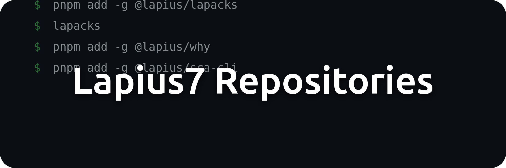

  

<b>English</b> | <a href="README.ja.md">日本語</a>

<h1 align="center">Lapius7 Repositories</h1>

<h3 align="center">A list of my public repositories.</h3>

A summary of the public repositories of <a href="https://github.com/Lapius7">Lapius7</a>. Every CLI tool installs with <code>pnpm add -g @lapius/&lt;name&gt;</code> (Linux / macOS / Windows).

  
  

  <a href="#cli-tools">CLI tools</a> ·
  <a href="#web-services-and-servers">Web services</a> ·
  <a href="#desktop-apps-and-browser-extensions">Desktop apps</a> ·
  <a href="#libraries">Libraries</a> ·
  <a href="#other">Other</a>

---

## CLI tools

| Repository | Command | Description | Language | Install |
|---|---|---|---|---|
| [lapacks](https://github.com/Lapius7/lapacks) | `lapacks` | A management CLI (with a TUI) that lists, installs, updates, and removes the @lapius CLI tools in the table below | Node.js | `pnpm add -g @lapius/lapacks` |
| [why](https://github.com/Lapius7/why) | `why` | Shows the cause and a fix for a failed command, in Japanese (offline, no AI) | Go | `pnpm add -g @lapius/why` |
| [ui-cli](https://github.com/Lapius7/ui-cli) | `ui` | Installs components from [shadcn.lapius7.com](https://shadcn.lapius7.com) through the shadcn CLI | TypeScript | `pnpm dlx @lapius/ui add <name>` |
| [bin-cli](https://github.com/Lapius7/bin-cli) | `bin` | Client for [LapBin](https://bin.lapius7.com). Log in with Lapount and share code from the terminal | Go | `pnpm add -g @lapius/bin-cli` |
| [ohatwikeeper-cli](https://github.com/Lapius7/ohatwikeeper-cli) | `ohax` | Official CLI for [おはツイKeeper](https://ohatwikeeper.com/cli). Shows profiles, trend graphs, awards, and more in full color | Go | `pnpm add -g @lapius/ohatwikeeper-cli` |
| [sca-cli](https://github.com/Lapius7/sca-cli) | `sca` | Terminal client for supabase-chat-app. Create rooms, chat, and see who is online | Go | `pnpm add -g @lapius/sca-cli` |
| [clilap](https://github.com/Lapius7/clilap) | `clilap` | Client for [clilap.org](https://clilap.org). Weather, cheat sheets, DNS, hashes, and more from the terminal | Node.js | `pnpm add -g @lapius/clilap` |
| [laping-lang](https://github.com/Lapius7/laping-lang) | `laping` | Laping (`.lp`): a minimal programming language implemented in C | C | `pnpm add -g @lapius/laping-lang` |
| [password-gl](https://github.com/Lapius7/password-gl) | `password-gl` `pgl` | Password / passphrase generator with fine-grained conditions (needs Python 3.9+) | Python | `pnpm add -g @lapius/password-gl` |
| [tsbuild](https://github.com/Lapius7/tsbuild) | `tsbuild` | Starts a Bun + TypeScript dev server with hot reload in one command (needs Python 3.9+) | Python | `pnpm add -g @lapius/tsbuild` |
| [tssetup](https://github.com/Lapius7/tssetup) | `tssetup` | Sets up a Bun + TypeScript frontend environment in one command (needs Python 3.9+) | Python | `pnpm add -g @lapius/tssetup` |
| [go-uuid](https://github.com/Lapius7/go-uuid) | `go-uuid` | An HTTP server that returns a UUID (v1 to v7) on every request ([demo](https://sandbox.lapius7.com/go-uuid/)) | Go | `pnpm add -g @lapius/go-uuid` |
| [clilap-codepush](https://github.com/Lapius7/clilap-codepush) | `codepush` | TUI client for [codepush.clilap.org](https://codepush.clilap.org) | Python | `pnpm add -g @lapius/clilap-codepush` |
| [cli-othello](https://github.com/Lapius7/cli-othello) | `othello` | Othello in the terminal. Play against an AI with 5 levels | Python | `pnpm add -g @lapius/cli-othello` |
| [ytdlpdownloader](https://github.com/Lapius7/ytdlpdownloader) | `yd` | A video, audio, and image downloader that drives yt-dlp from an fzf menu (also non-YouTube sites, with gallery-dl integration) | zsh | `pnpm add -g @lapius/ytdlpdownloader` |
| [dela-cli](https://github.com/Lapius7/dela-cli) | `dela` | A CLI that publishes a local port at https://xxxx.deploy.lapius7.com (own sish tunnel) | Go | `pnpm add -g @lapius/dela-cli` |
| [repomix-auto](https://github.com/Lapius7/repomix-auto) | `repomix-auto` | A CLI that automates Repomix source map generation (freshness check, config creation, automatic exclusion of heavy files) | TypeScript | `pnpm add -g @lapius/repomix-auto` |
| [x-archive-parser](https://github.com/Lapius7/x-archive-parser) | `x-archive-parser` | Converts an X (Twitter) archive into monthly Markdown / JSONL / CSV that a coding agent can grep | TypeScript | `pnpm add -g @lapius/x-archive-parser` |

## Web services and servers

| Repository | Description | Language |
|---|---|---|
| [clilap](https://github.com/Lapius7/clilap) | Developer tools you can use with `curl clilap.org` (weather, cheat sheets, GitHub, IP, DNS, WHOIS, UUID, Base64, and more) | Python |
| [transit.lapius7.com](https://github.com/Lapius7/transit.lapius7.com) | A route search web app that uses the Transit API ([site](https://transit.lapius7.com)) | TypeScript |
| [discordwidget-reloader](https://github.com/Lapius7/discordwidget-reloader) | A container that sends periodic PATCH requests to avoid the "waiting to sync" display of Discord Profile Widgets v2 | Python |
| [lapacks.lapius7.com](https://github.com/Lapius7/lapacks.lapius7.com) | A documentation site for the @lapius packages (the CLIs lapacks manages). It shows Markdown as one page per package (Next.js) | TypeScript |
| [md-publisher-api](https://github.com/Lapius7/md-publisher-api) | A service that turns Markdown sent through an API into a page only people who know the URL can read | TypeScript |
| [discord-messageapi-bot](https://github.com/Lapius7/discord-messageapi-bot) | A bot that saves the text and images posted to a Discord channel and returns them with a per-channel key | TypeScript |
| [diserverbuilder-mcp](https://github.com/Lapius7/diserverbuilder-mcp) | An MCP server that lets an AI assistant (Claude and others) rebuild a Discord server (categories, channels, roles, permissions) through your own bot | TypeScript |
| [gh.lapius7.com](https://github.com/Lapius7/gh.lapius7.com) | A GitHub activity dashboard. A dependency-free Node.js server caches GraphQL statistics and serves them ([site](https://gh.lapius7.com)) | JavaScript |
| [img-parameter.wks.lapius7.com](https://github.com/Lapius7/img-parameter.wks.lapius7.com) | A Cloudflare Workers API that resizes, crops, rotates, rounds, and converts images with URL parameters ([site](https://img-parameter.wks.lapius7.com)) | TypeScript |
| [r-place-readme](https://github.com/Lapius7/r-place-readme) | A README with a shared pixel canvas everyone draws on. Click a cell of the image to change its color ([site](https://r-place-readme.wks.lapius7.com)) | TypeScript |
| [ramen.lapius7.com](https://github.com/Lapius7/ramen.lapius7.com) | A ramen encyclopedia | TypeScript |
| [lapius7.si](https://github.com/Lapius7/lapius7.si) | Landing page for lapius7.si ([site](https://lapius7.si)) | TypeScript |

## Desktop apps and browser extensions

| Repository | Description | Language |
|---|---|---|
| [portality](https://github.com/Lapius7/portality) | A Windows app that visualizes ports and the network for developers (Tauri + React) | TypeScript |
| [coucou-repatch](https://github.com/Lapius7/coucou-repatch) | A fork of [Louis-CFM/coucou](https://github.com/Louis-CFM/coucou) for Windows / WSL. A small on-screen island that watches Claude Code work (permission prompts, edit diffs, plan limits) (Tauri) | TypeScript |
| [ohatwikeeper-extension](https://github.com/Lapius7/ohatwikeeper-extension) | A Chrome extension for one-click registration and stats display for おはツイKeeper ([intro](https://ohatwikeeper.com/extensions/oneclick_add/)) | HTML |
| [fixit-editor](https://github.com/Lapius7/fixit-editor) | Fixit Editor, a light code editor with a frosted-glass look (Tauri + React. [site](https://fixit-editor.lapius7.com)) | TypeScript |
| [fixiteditor-bgimgchanger](https://github.com/Lapius7/fixiteditor-bgimgchanger) | An extension for Fixit Editor. Change the background image, opacity, blur, and display mode from the settings screen | JavaScript |
| [dracon](https://github.com/Lapius7/dracon) | A file conversion app for Windows (Tauri + React + ffmpeg) | TypeScript |
| [lightcapturex](https://github.com/Lapius7/lightcapturex) | An ultra-light game recorder for Windows (GPU hardware encoding) | Rust |
| [valorant-matchfound](https://github.com/Lapius7/valorant-matchfound) | A Windows tray app that tells you through a Discord DM when a VALORANT match is found. It keeps updating the mode, map, and teammates' agent picks | Rust |
| [x-nomoretracking](https://github.com/Lapius7/x-nomoretracking) | A Chrome / Edge extension that removes tracking parameters such as s, t, and a added by "Copy link" on X | JavaScript |
| [TampermonkeyScripts](https://github.com/Lapius7/TampermonkeyScripts) | A place for my own Tampermonkey user scripts, such as the URL copy for fx○.lapius7.com | JavaScript |

## Libraries

| Repository | Description | Language | Install |
|---|---|---|---|
| [nixparse](https://github.com/Lapius7/nixparse) | Type-safe parsing of the output of `ps`, `df`, `du`, `free`, `lsof`, `ip`, `ss`, and more (runtime validation with Zod) | TypeScript | `npm i nixparse` |
| [go-rataliy_lib](https://github.com/Lapius7/go-rataliy_lib) | HTTP rate limiting for Go (token bucket, sliding / fixed window, net/http middleware, no dependencies) | Go | `go get github.com/Lapius7/go-rataliy_lib` |

## Other

| Repository | Description | Language |
|---|---|---|
| [lapius7.github.io](https://github.com/Lapius7/lapius7.github.io) | Portfolio site ([lapius7.github.io](https://lapius7.github.io)) | HTML |
| [swarm-build-skill](https://github.com/Lapius7/swarm-build-skill) | A Claude Code skill that makes, with Remotion, a video in which a swarm of colored cursors builds a page | TypeScript |
| [workerstest.wks.lapius7.com](https://github.com/Lapius7/workerstest.wks.lapius7.com) | A project for checking Cloudflare Workers | TypeScript |
| [Lapius7](https://github.com/Lapius7/Lapius7) | The GitHub profile README | — |
| [repos](https://github.com/Lapius7/repos) | This page | — |

> [!NOTE]
> This list is a rewrite of the table in the previous README. It was not checked against the current state of each repository.
